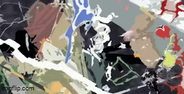

  

## Hello World! My name is Zacky Firdaus 👋

<!--
**Pulzzz06/Pulzzz06** is a ✨ _special_ ✨ repository because its `README.md` (this file) appears on your GitHub profile.

Here are some ideas to get you started:

- 🔭 I’m currently working on ...
- 🌱 I’m currently learning ...
- 👯 I’m looking to collaborate on ...
- 🤔 I’m looking for help with ...
- 💬 Ask me about ...
- 📫 How to reach me: ...
- 😄 Pronouns: ...
- ⚡ Fun fact: ...
-->
###### Right now, I'm an Informatics Engineering student at UIN SGD Bandung, learning to turn curiosity into code and ideas into real solutions.

- 🌱 I’m currently learning Javascript, Java, and MongoDB
- ⚡ Fun fact: I love music, exploring anything related to IT, and becoming better than I was yesterday.

##### 👩‍💻 Languages

##### 🚀 Frameworks & Library

##### 📊My Github Stats

##### 📞 Follow Me

Play Games with Me!

###

<picture data-importer="pacman">
  <source media="(prefers-color-scheme: dark)" srcset="https://raw.githubusercontent.com/Pulzzz06/Pulzzz06/pacman-output/pacman-contribution-graph-dark.svg?game=pacman">
  <source media="(prefers-color-scheme: light)" srcset="https://raw.githubusercontent.com/Pulzzz06/Pulzzz06/pacman-output/pacman-contribution-graph.svg?game=pacman">
  
</picture>

###

###